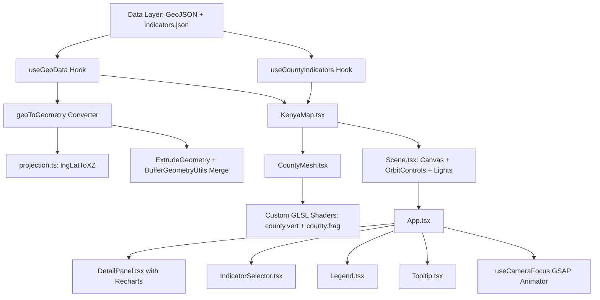

# Ramani 3D — Kenya Development Indicators 3D Explorer

[](https://github.com/crnjihia/kenya-relief-map-3d/actions/workflows/ci.yml)
[](LICENSE)
[](https://react.dev/)
[](https://threejs.org/)
[](https://vitejs.dev/)

An interactive 3D WebGL data visualisation of Kenya's 47 county-level development indicators. Population density, total population, Gross County Product (GDP per capita), and composite infrastructure scores are rendered as extruded 3D relief geometries on an architectural coordinate grid. Built with React Three Fiber, custom GLSL shaders, GSAP animations, and Recharts.

---

## Live Demo & Screenshots

- **Live Application:** [https://ramani-3d-kenya.vercel.app](https://ramani-3d-kenya.vercel.app)
- **Preview:**

```
┌────────────────────────────────────────────────────────────────────────────────────────┐
│  [3D] Ramani 3D — Kenya  [Population Density] [Population] [GDP/Cap] [Infrastructure]  │
├────────────────────────────────────────────────────────────────────────────────────────┤
│                                                                                        │
│                                      ▲  Mandera (Rank #14)                             │
│                           ▲        ▲▲▲                                                 │
│                     Turkana     Marsabit        ▲ Wajir                                │
│                       ▲▲▲▲                                                             │
│                         ▲▲    Kenya 3D Mesh                                            │
│                      ▲▲▲▲▲▲   (Custom GLSL Shader & Rim Light)                         │
│                     Kiambu ▲                                                           │
│                     NAIROBI ▲▲▲▲                                  [Detail Panel]       │
│                               ▲▲▲  Mombasa (5,495/km²)            - Nairobi County     │
│                                                                   - Pop: 4,397,073     │
│   [Legend: Low ────── Mid ────── High]                            - Recharts vs Nat'l  │
│                                                                   - Rank: #1 of 47     │
└────────────────────────────────────────────────────────────────────────────────────────┘
```

---

## Key Features

- **Extruded 3D Relief Mapping:** Kenya's 47 county boundaries parsed from GeoJSON and extruded into 3D geometries along the Y-axis.
- **Custom GLSL Shader:** Maps normalized indicator heights to a 5-stop color gradient ramp (`Deep Blue` → `Cyan` → `Emerald` → `Amber` → `Coral Red`) with directional key lighting and Fresnel rim lighting.
- **GSAP Height Morphing:** Instant, smooth animation transitions when switching indicators (e.g. Population Density to GDP per capita).
- **Interactive OrbitControls:** Rotate, pan, and zoom with constrained polar angles to maintain map orientation.
- **Click-to-Focus Camera:** Smooth GSAP camera animation zooms to focus on clicked counties.
- **Drill-Down Analytics Panel:** Slide-in drawer with Recharts bar chart comparing the selected county against national averages across all 4 indicators.
- **Real-Time Hover Tooltip HUD:** Glassmorphic floating HUD displays county rank, formatted metric value, and comparison vs national averages.

---

## Architecture



---

## Technical Stack

- **Core:** React 18, TypeScript, Vite
- **3D & WebGL:** Three.js (r186), React Three Fiber (`@react-three/fiber`), React Three Drei (`@react-three/drei`)
- **Shaders:** GLSL Vertex & Fragment shaders (sampling RGBA DataTexture ramps, rim lighting, contour bands)
- **Transitions:** GreenSock Animation Platform (`gsap`)
- **2D Analytics:** `recharts` (ResponsiveContainer, BarChart, ReferenceLine)
- **Styling:** Tailwind CSS (Dark glassmorphic HUD chrome)
- **Unit Testing:** Vitest (`projection.test.ts`, `normalise.test.ts`, `geoToGeometry.test.ts`)
- **CI/CD:** GitHub Actions (`.github/workflows/ci.yml`)

---

## Data Sources

1. **KNBS 2019 Kenya Population and Housing Census:**
   - 2019 National Census Volume I & II (County total population and land area).
2. **KNBS Gross County Product (GCP) Reports:**
   - County Gross Product economic estimates per capita in Kenyan Shillings (KES).
3. **Kenya National Infrastructure Index:**
   - Composite connectivity score (0–100) evaluating paved road networks, national power grid access, potable water coverage, and broadband cellular penetration.
4. **Administrative Boundaries:**
   - Independent Electoral and Boundaries Commission (IEBC) & GADM Level 1 Kenya County demarcations.

---

## Performance Optimizations

- **Geometry Memoization:** Geometries are parsed and converted to Three.js `BufferGeometry` once on load via `useMemo` in `useGeoData`.
- **Draw Call Reduction:** MultiPolygon components per county (such as islands in Lamu, Mombasa, and Lake Victoria) are merged into single unified BufferGeometries using `BufferGeometryUtils.mergeGeometries`.
- **Sub-Pixel Polygon Simplification:** High-vertex linear rings are simplified with a tolerance filter, keeping 60 FPS on mid-range laptops.
- **Shader Height Scaling:** Height morphing leverages `mesh.scale.y` and shader uniform interpolation via GSAP, avoiding expensive geometry rebuilds during user interactions.

---

## How to Update Indicator Data

Indicator datasets are stored as clean JSON files:
- Static public asset: `public/data/indicators.json`
- Source data backup: `src/data/indicators.json`

To update data for any county:
```json
{
  "code": 47,
  "id": "47",
  "name": "Nairobi",
  "capital": "Nairobi",
  "region": "Nairobi",
  "areaKm2": 703.9,
  "population": 4397073,
  "populationDensity": 6247,
  "gdpPerCapita": 645000,
  "infrastructureScore": 93.0
}
```
Run `npm run build` or start `npm run dev` to see immediate updates.

---

## Getting Started

### Prerequisites
- Node.js >= 18
- npm >= 9

### Installation
```bash
# Clone the repository
git clone https://github.com/crnjihia/kenya-relief-map-3d.git
cd kenya-relief-map-3d

# Install dependencies
npm install

# Run unit tests
npm test

# Launch Vite development server
npm run dev
```

### Production Build
```bash
npm run build
npm run preview
```

---

## License

MIT License. See [LICENSE](LICENSE) for full details.
