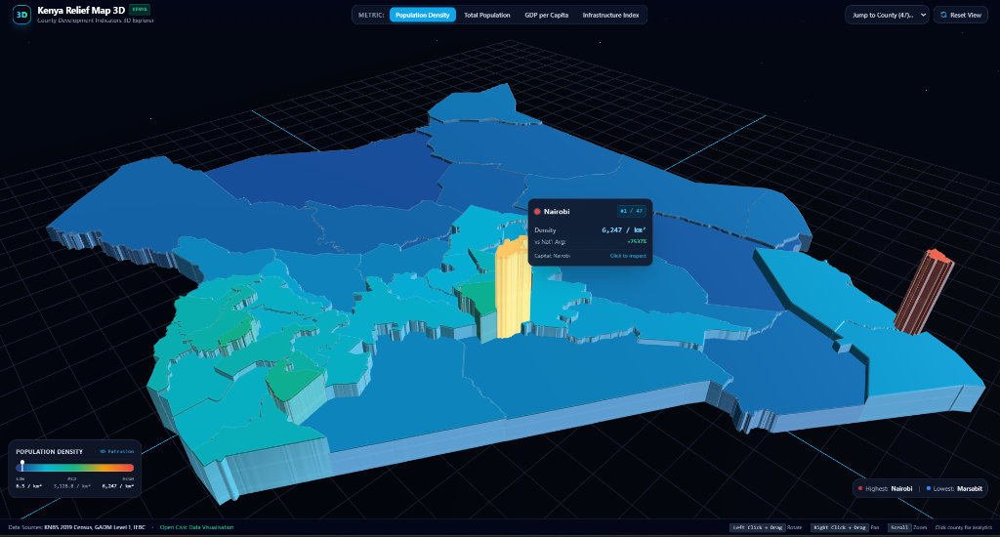
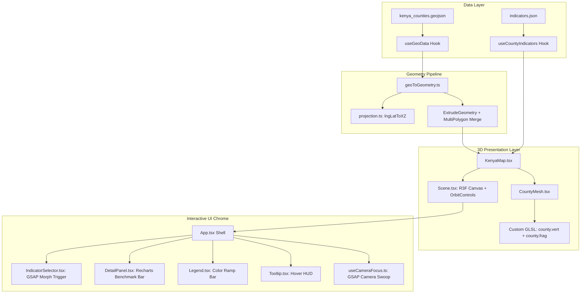

<div align="center">

# Kenya Relief Map 3D

### An Interactive 3D WebGL Visualisation of Kenya's County-Level Development Indicators

[](https://github.com/crnjihia/kenya-relief-map-3d/actions/workflows/deploy.yml)
[](https://github.com/crnjihia/kenya-relief-map-3d/actions/workflows/ci.yml)
[](LICENSE)
[](https://react.dev/)
[](https://threejs.org/)
[](https://vitejs.dev/)
[](https://github.com/crnjihia/kenya-relief-map-3d/releases)

<br/>

<a href="https://crnjihia.github.io/kenya-relief-map-3d/">
  
</a>

<br/>
<br/>

[**🌐 Live Demo on GitHub Pages**](https://crnjihia.github.io/kenya-relief-map-3d/) • [**📊 Data Sources**](#-data-sources--methodology) • [**⚙️ Architecture**](#-system-architecture) • [**🚀 Deployment**](#-github-pages-deployment-guide)

</div>

---

## 🧭 Overview

**Kenya Relief Map 3D** is an interactive, open-source civic data visualization tool mapping Kenya’s 47 counties into a physical 3D relief model. Key socioeconomic and demographic indicators are mapped directly to 3D vertical extrusion heights and a perception-tuned GLSL color gradient.

Whether exploring urban density contrasts across Nairobi and Mombasa, or assessing regional infrastructure disparities, users can seamlessly rotate, tilt, and zoom through Kenya's geography and drill down into per-county comparative benchmarks.

### 🌟 Key Highlights

- **Extruded 3D County Relief:** All 47 official county administrative boundaries parsed from GeoJSON and extruded into 3D geometries on the XZ ground plane.
- **Custom GLSL Shader:** Maps normalized indicator heights to a vibrant 5-stop color gradient ramp (`Deep Blue` $\rightarrow$ `Cyan` $\rightarrow$ `Emerald Green` $\rightarrow$ `Amber Gold` $\rightarrow$ `Coral Red`) with directional sun shading and Fresnel rim lighting.
- **Smooth GSAP Height Morphing:** Switch between metrics with animated 3D height scale and color interpolation.
- **Click-to-Focus Camera:** Smooth GSAP camera transition automatically swoops down and frames clicked counties.
- **Comparative Analytics Drawer:** Slide-in detail panel featuring Recharts horizontal bar charts benchmarking the selected county against national averages.
- **Glassmorphic HUD & Tooltip:** Real-time hover HUD tracking county ranking (`#X of 47`), metric value, and comparison vs national benchmarks.

---

## 🎮 Interactive Controls

| Input | Action |
| :--- | :--- |
| **Left Click + Drag** | Orbit and rotate the 3D map around the center |
| **Right Click + Drag** (or Shift + Left Click) | Pan the camera horizontally and vertically |
| **Mouse Wheel / Pinch** | Smoothly zoom in and out |
| **Hover on County** | Highlight county with emissive glow and display HUD tooltip |
| **Click on County** | Swoop camera to focus and slide open the county analytics drawer |
| **Metric Buttons (Top)** | Morph 3D extrusion heights between Population Density, Population, GDP, and Infrastructure |
| **County Selector (Top Right)** | Jump directly to any of the 47 counties |
| **Reset View Button / ESC** | Return the camera to the national perspective |

---

## 🏗️ System Architecture



---

## 📊 Data Sources & Methodology

1. **KNBS 2019 Kenya Population and Housing Census:**
   - Total county population and land surface area (Volume I & II).
   - Population density calculated as $\text{residents} / \text{km}^2$.
2. **Gross County Product (GCP) Reports (KNBS):**
   - Gross domestic output per county divided by population to estimate GDP per capita in Kenyan Shillings (KES).
3. **Composite Infrastructure Index (0–100):**
   - Weighted composite index incorporating paved road accessibility, electricity grid connectivity, potable piped water access, and cellular broadband coverage.
4. **Administrative Boundaries:**
   - Independent Electoral and Boundaries Commission (IEBC) & GADM Level 1 Kenya County demarcations.

---

## 🛠️ Tech Stack

- **Framework:** [React 18](https://react.dev/) + [Vite](https://vitejs.dev/) + [TypeScript](https://www.typescriptlang.org/)
- **3D / WebGL:** [Three.js (r186)](https://threejs.org/) + [React Three Fiber](https://docs.pmnd.rs/react-three-fiber) + [Drei](https://github.com/pmndrs/drei)
- **Shaders:** Custom GLSL Vertex and Fragment shaders (RGBA DataTexture ramp sampling, Fresnel rim light, elevation contours)
- **Animation:** [GSAP 3](https://greensock.com/gsap/)
- **Charts:** [Recharts](https://recharts.org/)
- **Styling:** [Tailwind CSS](https://tailwindcss.com/)
- **Testing:** [Vitest](https://vitest.dev/)
- **CI / CD:** GitHub Actions (`deploy.yml` + `ci.yml`)

---

## 🚀 GitHub Pages Deployment Guide

This repository includes automated GitHub Actions deployment. To publish your live map:

1. **Push your code to GitHub:**
   ```bash
   git push -u origin main
   ```
2. **Enable GitHub Pages:**
   - In your repository on GitHub, navigate to **Settings** $\rightarrow$ **Pages**.
   - Under **Build and deployment** $\rightarrow$ **Source**, choose **GitHub Actions**.
3. **Automatic Deployment:**
   - The `.github/workflows/deploy.yml` workflow will automatically run, build the production bundle, and publish the site to:
     ```text
     https://<your-username>.github.io/kenya-relief-map-3d/
     ```

---

## 💻 Local Development Setup

### Prerequisites
- Node.js >= 18.0.0
- npm >= 9.0.0

### Quick Start
```bash
# 1. Clone the repository
git clone https://github.com/crnjihia/kenya-relief-map-3d.git
cd kenya-relief-map-3d

# 2. Install dependencies
npm install

# 3. Run unit tests
npm test

# 4. Start local development server
npm run dev
```

### Production Build & Preview
```bash
# Build optimized bundle
npm run build

# Preview build locally
npm run preview
```

---

## 🧪 Testing

The test suite validates spatial projections, unit scaling, and geometry generation:

```bash
npm test
```

Test suites cover:
- `tests/projection.test.ts`: Kenya bounding box ($33.9^\circ \text{–} 41.9^\circ \text{ E}, -4.8^\circ \text{–} 4.7^\circ \text{ N}$) conversion and inverse projection.
- `tests/normalise.test.ts`: Clamping bounds, perceptual power-law scaling, and currency/unit formatting.
- `tests/geoToGeometry.test.ts`: 3D ExtrudeGeometry construction and MultiPolygon archipelago merging.

---

## 📄 License

This project is open-source and distributed under the [MIT License](LICENSE).
